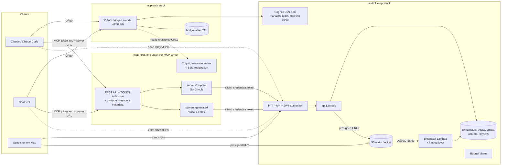

# audiofile-api

A small music-library REST API on AWS (Go, SAM, Lambda, DynamoDB, S3, Cognito) plus the pieces needed to put MCP servers in front of it: an OAuth bridge so Claude and ChatGPT can sign in, a reusable MCP hosting template, a throwaway test MCP server, and a generated MCP server. It is the raw material for a YouTube video about why one MCP tool per endpoint is the lazy default and curated, task-shaped tools are better.

The base comes from the audiofile API in Chapter 3 of my book *Building Modern CLI Applications in Go* ([original repo](https://github.com/marianina8/audiofile)). This version was extended and published separately. The original read tags with `github.com/dhowden/tag` and transcribed audio with AssemblyAI; this one reads tags with `ffprobe`, measures BPM and energy with `ffmpeg` plus a pure-Go tempo detector, and drops transcription.

Only the owner of the Cognito user pool can use a deployed copy. There is one shared library and no per-user data.

## Architecture



Three kinds of stack:

- **audiofile-api** (`template.yaml`): Cognito user pool with managed login, a CLI app client, a machine app client for MCP-to-API calls, an HTTP API with a JWT authorizer, the `api` Lambda, the S3-triggered `processor` Lambda with an ffmpeg/ffprobe layer, a private S3 bucket, four DynamoDB tables, and a $10/month budget.
- **mcp-auth** (`auth/`): the OAuth bridge (Lambda behind its own HTTP API) and a small DynamoDB table with TTL. It sits in front of Cognito and speaks the MCP authorization flow (metadata discovery, DCR, client ID metadata documents, PKCE).
- **mcp-host** (`mcphost/`, nested by each server's template): a REST API with a TOKEN authorizer that checks signature, issuer, audience and the `mcp-users` group; the protected-resource metadata document; a Cognito resource server; and an SSM parameter that registers the server's URL with the bridge. It currently fronts `servers/mcptest` and `servers/generated`.

Resource names are CloudFormation-generated. URLs are the default execute-api URLs.

## Endpoints

34 routes: 33 API routes plus the public `GET /play/{pid}`. Only `/health` and `/play/{pid}` need no token. The rest need a Cognito access token: GET routes need scope `audiofile/read`, everything else `audiofile/write`. The OpenAPI spec is `openapi.yaml`; a Go test keeps it, `template.yaml` and the router in sync.

| Group | Routes |
|---|---|
| Health and player | `GET /health`, `GET /play/{pid}` (short link, 1 hour, 128-bit random id) |
| Legacy (book shapes) | `POST /upload` (mp3, under ~4.5 MB), `GET /request?id=`, `GET /list` |
| Tracks | `POST /tracks/uploads` (presigned PUT), `GET /tracks`, `GET/PATCH/DELETE /tracks/{id}`, `GET /tracks/{id}/stream`, `GET /tracks/{id}/status` |
| Search and catalog | `GET /search` (q, artist, genre, year, bpm and energy ranges), `GET /artists`, `/artists/{id}`, `/artists/{id}/tracks`, `/artists/{id}/albums`, `GET /albums`, `/albums/{id}`, `/albums/{id}/tracks`, `GET /genres`, `GET /tags` |
| Tags | `POST /tracks/{id}/tags`, `DELETE /tracks/{id}/tags/{tag}` |
| Playlists | `POST/GET /playlists`, `GET/PATCH/DELETE /playlists/{id}`, `GET/POST /playlists/{id}/tracks`, `DELETE /playlists/{id}/tracks/{trackId}`, `PUT /playlists/{id}/tracks/order`, `POST /playlists/{id}/player` |

The legacy routes (`/upload`, `/request`, `/list`) keep the book's response shapes so the original CLI idea still maps onto this API. `/tracks/{id}/stream` and the playlist player both return a short `/play/<pid>` link served by the API, so the address bar never shows a presigned S3 URL.

## Prerequisites

- Go 1.25+
- AWS SAM CLI and AWS CLI v2
- `ffmpeg` and `ffprobe` (tests, seeding)
- Docker (DynamoDB Local tests, and `make layer` which copies static ffmpeg binaries out of a digest-pinned image)
- Node 22+ (the generated MCP server)
- `jq`, `curl`
- An AWS CLI profile named `audiofile-admin`, a scoped identity (not root). See [docs/aws-setup.md](docs/aws-setup.md), including the SAM SSO workaround: if `sam deploy` fails with `GetRoleCredentials ... No access`, run `eval "$(aws configure export-credentials --profile audiofile-admin --format env)"` and `export AWS_REGION=us-west-2` first.

Region is `us-west-2`.

## Deploy

Order matters. Pass your own values; nothing personal is committed.

```sh
# 1. ffmpeg layer, then build
make layer
make build

# 2. the API stack (budget alert email and a globally unique Cognito domain prefix)
sam deploy --parameter-overrides AlertEmail=you@example.com CognitoDomainPrefix=<unique-prefix>

# 3. create your user, then set a permanent password
scripts/add-user.sh you@example.com
scripts/set-password.sh          # run in a normal terminal: it needs a TTY

# 4. store the machine client secret in SSM (CloudFormation can't create SecureStrings)
scripts/store-machine-secret.sh

# 5. the OAuth bridge (add ChatGPTCallbackId=<id> once ChatGPT shows you its callback)
cd auth && sam deploy && cd ..

# 6. the test MCP server (two tools) behind mcp-host
scripts/deploy-mcp.sh servers/mcptest

# 7. on camera: generate the one-tool-per-endpoint server, patch it, deploy it
scripts/generate-server.sh --patch
scripts/deploy-mcp.sh servers/generated
```

Then `source scripts/token.sh` and run `scripts/smoke.sh`. The connector URL for each MCP server is the `deployed <name>: <McpUrl>` line `deploy-mcp.sh` prints.

## Seed the library

Audio never lives in the repo. Put hand-downloaded MP3s in `~/audio` (the Pixabay terms forbid automated downloading).

```sh
scripts/draft-library.sh          # writes ~/audio/library.csv from the filenames
source scripts/token.sh
scripts/seed.sh --dry-run         # no network: shows what would happen
scripts/seed.sh
```

`seed.sh` prints title, artist, genre, TBPM and copyright for every file; flags NonCommercial licences (`NonCommercial`, `BY-NC`, `CC-NC`) and skips them unless `--include-nc`; drops duplicates by SHA-256 (within the folder and against tracks already uploaded); asks before uploading; then waits for each track to become `ready` and prints bpm, bpm source, energy and the spread. Original files are never modified.

I also tried guessing missing genres with a Bedrock audio model. It did not work (the Converse API rejected audio for that model); genre stays blank for those tracks. See [docs/notes/genre-guess.md](docs/notes/genre-guess.md). "Upbeat" uses bpm and energy, not genre.

## Scripts

| Script | What it does |
|---|---|
| `scripts/token.sh` | `source` it. Signs in as the pool user, exports `TOKEN`. Prints only the expiry |
| `scripts/machine-token.sh` | `source` it. Client-credentials token for the machine client, exports `MACHINE_TOKEN` |
| `scripts/smoke.sh` | 401 on every protected route without a token, every route works with one. Uses temporary data only |
| `scripts/reset-playlists.sh` | Deletes all playlists (run before recording) |
| `scripts/try-workout-mix.sh` | Builds an "upbeat workout mix" by hand through the API and opens the player |
| `scripts/add-user.sh <email>` | Creates a pool user in the `mcp-users` group. They get the whole shared library |
| `scripts/set-password.sh` | Completes first sign-in with a permanent password (needs a TTY) |
| `scripts/store-machine-secret.sh` | Copies the machine client secret into SSM as a SecureString |
| `scripts/draft-library.sh`, `scripts/seed.sh` | Library CSV and seeding, above |
| `scripts/generate-server.sh [--patch] [--force]` | Runs openapi-mcp-generator 4.1.0 into `servers/generated/app` (not in git) |
| `scripts/patch-generated-server.sh <dir>` | Makes the generated server work on Lambda: stateless transport, request-body fix, `PORT`, machine-token auth. Idempotent |
| `scripts/deploy-mcp.sh <dir>` | Builds and deploys an MCP server stack, then forces a fresh API Gateway deployment. `STACK_NAME` and `SERVER_NAME` (set both) deploy a rehearsal stack that can't touch the real one |

## Testing

```sh
go test ./...        # unit tests, spec/template/router coverage test
make test-dynamo     # store and OAuth contracts against DynamoDB Local (Docker)
make lint-spec       # redocly lint of openapi.yaml
scripts/test/*.sh    # script guards, smoke dry run, generated-server test
```

Tests that need ffmpeg skip with a message if it isn't installed.

## Teardown

Delete in reverse order. `sam delete` does not empty S3 buckets, so empty the bucket first or the stack delete fails.

```sh
sam delete --stack-name mcp-generated        # if you deployed it
sam delete --stack-name mcp-test
sam delete --stack-name mcp-auth
aws s3 rm s3://<BucketName> --recursive       # BucketName is a stack output of audiofile-api
sam delete --stack-name audiofile-api
```

This deletes the library. `~/audio` is the backup, so `scripts/seed.sh` re-seeds it. If SAM hits the SSO error, use the export-credentials workaround from [docs/aws-setup.md](docs/aws-setup.md) first.

## Limits and notes

- Search and catalog endpoints scan the tracks table. Fine up to about 2,000 tracks.
- Identity behind MCP is single-tenant: the MCP server calls the API with a machine token, so the API can't tell which user is behind a call. One shared library, one set of playlists.
- Default execute-api URLs change if a stack is deleted and recreated, which breaks connectors and ChatGPT's callback. Do not recreate stacks before a recording.
- Tool-approval behaviour differs by app. Summary in [TEST-APPROVALS.md](TEST-APPROVALS.md): ChatGPT leans on hints and tool names, Claude Code asks for everything by default, Claude Desktop defaults to allow.
- Cognito remembers your session and may skip the sign-in page. Use a private window when recording.
- Lambda caps request payloads at about 6 MB (legacy `/upload`); real uploads use presigned URLs.

## Account hygiene

Turn on MFA for the root user and don't use it for this. Use short-lived credentials (IAM Identity Center) with no long-lived access keys. The `audiofile-admin` identity is scoped to the services these stacks use. Cognito self sign-up is off. No secrets, account IDs, emails or tokens belong in the repo; the budget email and Cognito prefix are deploy-time parameters.

## Docs

- [LEARN-MCP.md](LEARN-MCP.md): short hands-on MCP lab
- [OAUTH-FLOW-STORYBOARD.md](OAUTH-FLOW-STORYBOARD.md): the login flow in plain language
- [TEST-APPROVALS.md](TEST-APPROVALS.md): how each app asks before calling tools
- [DRYRUN-REPORT.md](DRYRUN-REPORT.md): what the MCP generator produces from this spec
- [docs/aws-setup.md](docs/aws-setup.md): the `audiofile-admin` identity and SSO notes
- [docs/notes/genre-guess.md](docs/notes/genre-guess.md), [docs/notes/resource-binding.md](docs/notes/resource-binding.md): findings
- [docs/superpowers/specs/2026-10-20-audiofile-api-design.md](docs/superpowers/specs/2026-10-20-audiofile-api-design.md): design spec
