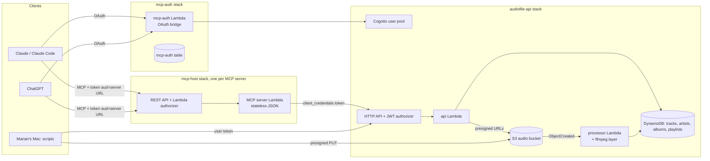

# audiofile-api — design

Date: 2026-10-20 · Status: draft for approval

## 1. Intent

audiofile-api is the raw material for a YouTube video. The video's lesson: **generating one MCP tool per endpoint is the lazy default; curating endpoints into a few task-shaped tools (some orchestrating several endpoints) is an important, often necessary step.** On camera, a generated TypeScript MCP server (from this API's OpenAPI spec) and a hand-designed Go MCP server are both asked something like *"create a workout mix that's upbeat"*. The generated one should stumble on a realistic multi-call chain (interpret "upbeat" → search with bpm/energy filters → create playlist → add tracks → order them); the Go one should get it right.

This phase builds, deploys and secures the API, the OAuth bridge and reusable MCP hosting, a throwaway test MCP server, a generator dry run, the music library, helper scripts, and a short MCP lab. **The two video MCP servers are not built now.**

The base is the audiofile API from Chapter 3 of Marian's book (https://github.com/marianina8/audiofile, identical to `Chapter03/audiofile` in https://github.com/PacktPublishing/Building-Modern-CLI-Applications-in-Go). That repo is not modified.

## 2. Goals, non-goals, anti-goals

Goals
- A granular, endpoint-shaped REST API (33 routes) whose playlist area is complete enough that "make an upbeat workout mix" genuinely needs several calls.
- An ordinary, real-world-looking OpenAPI 3.1 spec, kept in sync with code by a test.
- Every track has a reliable `bpm` and `energy` so "upbeat" actually filters.
- Remote MCP servers connect from Claude (claude.ai + Claude Code) and ChatGPT via OAuth with Cognito as the identity provider, following the MCP authorization spec (2026-07-28 revision).
- Only Marian can use any of it.
- Hosting is reusable: the two video servers later deploy behind the same auth with no auth code of their own.

Non-goals
- Transcription (dropped entirely).
- Uploads through MCP. Audio only enters via `scripts/seed.sh`.
- Multi-user data. One shared library and set of playlists.
- Building the two video MCP servers.
- Scale: search and aggregate endpoints scan the tracks table; this is fine at ~20–2,000 tracks and documented as a limit.

Anti-goals (failure even if it "works")
- Tuning the API or spec to make the generated server look bad (or good). No artificial one-item-per-call endpoints, no AI-flavoured descriptions, no composite convenience endpoints like `POST /playlists/from-search`.
- Any secret, account ID, email or token in the repo, logs, or terminal output.
- NonCommercial or Content-ID-registered audio in the library.
- An OAuth bridge that creates a Cognito app client per connection, or that has open redirects.

## 3. Constraints

- Go; AWS SAM; Lambda `provided.al2023` arm64. Local default region is `us-west-2` (confirm at first deploy, along with which AWS CLI profile to use).
- No AWS action, paid resource, or browser step without asking first (see §13).
- Commit after every task.
- Lambda request payload limit ≈ 6 MB (affects legacy `POST /upload`).
- API Gateway HTTP API does not stream responses and does not allow customizing its 401 response.
- Cognito: no DCR; exact-match callback URLs (no wildcard ports); its OIDC discovery doc omits `code_challenge_methods_supported` (breaks ChatGPT and reportedly Claude Code); no `/.well-known/oauth-authorization-server`; no RFC 9207 `iss` in authorization responses; 1,000 app clients/pool.
- Pixabay music: commercial use OK, no music API, terms forbid automated downloading. Marian downloads by hand.

## 4. Architecture

Three SAM stacks.

1. **audiofile-api**: Cognito user pool (and all its app clients, resource server, group), HTTP API with JWT authorizer, one `api` Lambda serving all 33 routes, `processor` Lambda (S3-triggered) with an ffmpeg/ffprobe layer, private S3 bucket, 4 DynamoDB tables, stage throttling, $10/month budget.
2. **mcp-auth**: the OAuth bridge (one Go Lambda behind its own HTTP API) and a small DynamoDB table with TTL.
3. **mcp-host**: a reusable template, parameterized by server name and code, that puts one MCP server at an HTTPS URL behind the bridge. Deployed now for the throwaway test server; later once per video server.

Resource names are CloudFormation-generated (no account IDs in names).

URLs (decided by Marian): AWS default execute-api URLs, no custom domain. The bridge uses an HTTP API `$default` stage, so its issuer has no stage prefix. mcp-host REST APIs carry a stage segment (e.g. `…/Prod/mcp`), so a host-root `/.well-known/oauth-protected-resource` is impossible; discovery relies on the `WWW-Authenticate` `resource_metadata` pointer (plus the path-scoped document under the stage). URLs change if a stack is deleted and recreated, which breaks connector setups and the ChatGPT callback; README and the pre-recording checklist warn against recreating stacks before a recording.

## 5. Data model

Four on-demand DynamoDB tables (chosen over single-table design for readability; viewers may see the console). DynamoDB enforces only keys; the Go code enforces the rest. Types: S string, N number, L list, SS string set.

### tracks
| Field | Dynamo | Go | Notes |
|---|---|---|---|
| `id` | S | `string` | Partition key. UUID |
| `status` | S | `TrackStatus` | enum `processing` \| `ready` \| `failed` |
| `error` | S | `string` | Human-readable message; present only when `failed` |
| `title` | S | `string` | From tag; filename fallback |
| `artist` | S | `string` | Display name |
| `artist_id` | S | `string` | Slug. PK of GSI `by-artist` (SK `title`) |
| `album` | S | `string` | Display name |
| `album_id` | S | `string` | Slug. PK of GSI `by-album` (SK `track_number`). Absent when no album (sparse) |
| `track_number` | N | `int` | 0 if missing |
| `album_artist` | S | `string` | For legacy shape |
| `composer` | S | `string` | For legacy shape |
| `comment` | S | `string` | For legacy shape |
| `genre` | S | `string` | |
| `year` | N | `int` | 0 if unknown |
| `lyrics` | S | `string` | |
| `copyright` | S | `string` | Copyright/license tag if present |
| `bpm` | N | `float64` | 1 decimal |
| `bpm_source` | S | `BPMSource` | enum `tag` \| `measured` \| `manual` |
| `energy` | N | `float64` | 0.00–1.00 |
| `duration_seconds` | N | `float64` | |
| `s3_key` | S | `string` | `tracks/{id}.mp3` |
| `original_filename` | S | `string` | |
| `size_bytes` | N | `int64` | |
| `content_sha256` | S | `string` | Hex SHA-256 of the file, supplied at upload; used by seed.sh to skip duplicates (builder's call) |
| `tags` | SS | `[]string` | User tags; absent when empty, API returns `[]` |
| `created_at`, `updated_at` | S | `string` | RFC 3339 UTC |

### artists
`id` S (PK, slug e.g. `beat-doctor`), `name` S, `created_at` S. Counts are computed, never stored.

### albums
`id` S (PK, slug of artist + title, e.g. `beat-doctor--best-bytes-volume-4`), `title` S, `artist_id` S (PK of GSI `by-artist`, SK `year`), `artist` S, `year` N, `created_at` S.

### playlists
`id` S (PK, UUID), `name` S (required), `description` S, `track_ids` L of S (ordered; position = play order; no duplicates, enforced in code), `created_at` S, `updated_at` S.

Behavioural rules (decided)
- Artists/albums are upserted by the processor from tags (and by `PATCH /tracks/{id}` when artist/album change). Slugs make reprocessing idempotent.
- Adding a track already in a playlist is a no-op.
- Deleting a track removes it from every playlist and deletes its S3 object.
- `GET /tracks` is paginated; legacy `/list` is not.

## 6. Processing (S3 ObjectCreated → processor Lambda)

Trigger: objects under `tracks/` ending `.mp3`. Memory 1 GB, timeout 60 s (builder may tune), `/tmp` for the downloaded file.

| Job | Tool |
|---|---|
| Tags: title, artist, album, album_artist, composer, genre, year/date, lyrics, comment, track, TBPM, copyright; duration | `ffprobe -show_format -show_streams -of json` |
| Energy | `ffmpeg -af ebur128` → integrated LUFS; energy = clamp((LUFS + 24) / 18, 0, 1), 2 decimals |
| BPM when no valid TBPM | `ffmpeg` decodes 60 s from the middle (`-ss`/`-t`, `-ac 1 -ar 22050 -f f32le pipe:1`) → Go tempo detector |

BPM precedence: valid TBPM (40–250) → `tag`; else measured → `measured`; `PATCH bpm` → `manual`. Reprocessing never overwrites `manual`.

Tempo detector (pure Go, ~150 lines): onset-strength envelope (spectral flux or band energy flux, ~86 Hz frame rate) → autocorrelation over lags for 60–200 BPM → log-Gaussian prior centred on 120 BPM to reduce half/double errors → parabolic peak refinement. Known weakness (half/double tempo) is mitigated by the prior; `PATCH bpm` is the escape hatch.

Energy risk: commercial masters cluster at −14…−8 LUFS, so calm-but-loud tracks may score high. After seeding, print the spread; if "upbeat" doesn't separate, show Marian the numbers before changing the mapping.

ffmpeg layer: static arm64 ffmpeg + ffprobe (~80 MB unzipped), downloaded at build time by `make layer` from a pinned URL with checksum verification. Binaries are never committed (GPL; size).

Status: `processing` → `ready` | `failed` (with `error` message). Title fallback when the tag is empty: best-effort from the filename (Pixabay names look like `artist-title-123456.mp3`); `artist` falls back to `Unknown Artist`.

Tests: synthetic click tracks at 90/120/128/174 BPM and tones at known loudness, generated through real ffmpeg; tests skip with a clear message if ffmpeg isn't installed. A local-only check reads the book's `beatdoctor.mp3` (TBPM 124) from a path given by env var; that file is never committed (CC BY-NC).

## 7. API

All JSON, snake_case. Errors: `{"error": {"code": "not_found", "message": "..."}}` with appropriate 4xx/5xx. All routes except `/health` require a JWT; GET routes require scope `audiofile/read`, all others `audiofile/write`.

### Legacy (same shapes as the book)
| Route | Behaviour |
|---|---|
| `POST /upload` | multipart field `file`; writes to S3 → normal processing; responds `200` with the track id as plain text. Over the Lambda payload cap → `413` with a clear message (seeding uses presigned URLs) |
| `GET /request?id=` | book `Audio` JSON: `Id`, `Path` (S3 key), `Metadata{tags{title,album,artist,album_artist,composer,genre,year,lyrics,comment}, transcript: ""}`, `Status`, `Error []string`. Status mapping: `processing`→`"Initiating"`, `ready`/`failed`→`"Complete"` (failed carries its message in `Error`, as the book did). Missing id → `400` (book returned 500; my call), unknown → `404` |
| `GET /list` | array of `Audio`, unpaged |

### New
| Route | Behaviour |
|---|---|
| `POST /tracks/uploads` | body `{filename, size_bytes, content_sha256?, content_type?}` (mp3 only, ≤ 50 MB). Creates track (`processing`), returns `201 {track_id, upload_url, upload_method: "PUT", upload_headers, expires_at}`; presigned PUT for 15 min, signed for content type and length |
| `GET /tracks` | `?limit=` (default 50, max 100) `&cursor=`; `{items: [Track], next_cursor}` |
| `GET /tracks/{id}` | Track |
| `PATCH /tracks/{id}` | any of `title, artist, album, genre, year, lyrics, bpm`; `bpm` sets `bpm_source=manual`; artist/album changes relink (creating as needed) |
| `DELETE /tracks/{id}` | `204`; removes from playlists, deletes S3 object |
| `GET /tracks/{id}/stream` | `{url, expires_at}` presigned GET, 15 min (JSON, not a redirect; my call) |
| `GET /tracks/{id}/status` | `{id, status, error?}` |
| `GET /search` | `q` (case-insensitive substring of title/artist/album), `artist` (id or name), `genre` (case-insensitive), `year`, `bpm_min`, `bpm_max`, `energy_min`, `energy_max`, `limit`; ready tracks only; `{items: [Track]}` |
| `GET /artists` | `{items: [{id, name, track_count}]}` |
| `GET /artists/{id}` | `{id, name, track_count, album_count}` |
| `GET /artists/{id}/tracks` | `{items: [Track]}` |
| `GET /artists/{id}/albums` | `{items: [Album]}` |
| `GET /albums` | `{items: [Album]}` (Album = `{id, title, artist_id, artist, year, track_count}`) |
| `GET /albums/{id}` | Album |
| `GET /albums/{id}/tracks` | `{items: [Track]}` ordered by track number |
| `GET /genres` | `{items: [{name, track_count}]}` |
| `GET /tags` | `{items: [{name, track_count}]}` |
| `POST /tracks/{id}/tags` | `{tags: [..]}` → Track. Tags normalized: lowercase, trimmed, `[a-z0-9-]`, ≤ 32 chars |
| `DELETE /tracks/{id}/tags/{tag}` | `204` |
| `POST /playlists` | `{name, description?, track_ids?}` → `201` Playlist |
| `GET /playlists` | `{items: [{id, name, description, track_count, created_at, updated_at}]}` |
| `GET /playlists/{id}` | Playlist incl. `track_ids` |
| `PATCH /playlists/{id}` | `name`, `description` |
| `DELETE /playlists/{id}` | `204` |
| `GET /playlists/{id}/tracks` | `{items: [Track]}` in play order |
| `POST /playlists/{id}/tracks` | `{track_ids: [..], position?}` (insert at position, default append). Unknown or non-ready ids → `400` listing them |
| `DELETE /playlists/{id}/tracks/{trackId}` | `204` |
| `PUT /playlists/{id}/tracks/order` | `{track_ids: [..]}`; must be a permutation of current ids, else `400` |
| `POST /playlists/{id}/player` | `201 {url, expires_at}`: a private link, valid 1 hour, to a static HTML player page for the playlist (see below). Empty playlist → `400` |
| `GET /health` | `{status: "ok"}`, unauthenticated |

Total: 33 routes.

### Playlist player
Lets Marian listen to a playlist right after it's created via MCP ("create an upbeat workout mix" → link → click → it plays). The api Lambda renders an embedded `html/template` page (track list with title/artist/bpm, `<audio>` element, play/next/previous, auto-advance; no external scripts or fonts) with presigned GET URLs for each track, writes it to `players/{playlist_id}/{random}.html` (`Content-Type: text/html`), and returns a 1-hour presigned GET URL for the page. Track URLs are presigned slightly longer than the page. An S3 lifecycle rule expires `players/` objects after 1 day. No login, no hosting, no public bucket; anyone holding the link can listen until it expires (accepted). Stretch idea for the video, not this phase: render the player inline via MCP Apps from the Go server.

### OpenAPI
`openapi.yaml` (3.1) hand-written in the style of a typical real spec: `operationId`s, short `summary` lines ("Get a playlist"), minimal or absent `description`s, enums where the code has them, shared component schemas. Not tuned for AI. Must pass `npx @redocly/cli lint openapi.yaml`.

A Go test fails if the routes registered in the router, the routes declared in `template.yaml`, and the paths/methods in `openapi.yaml` differ in any direction.

## 8. Auth

### A. Apps → MCP server (OAuth bridge, `mcp-auth`)
The bridge is a small OAuth authorization server in front of Cognito. Issuer = the bridge's base URL.

Endpoints
- `GET /.well-known/oauth-authorization-server` (RFC 8414): `issuer`, `authorization_endpoint`, `token_endpoint`, `registration_endpoint`, `response_types_supported: [code]`, `grant_types_supported: [authorization_code, refresh_token]`, `code_challenge_methods_supported: [S256]`, `token_endpoint_auth_methods_supported: [none]`, `client_id_metadata_document_supported: true`, `authorization_response_iss_parameter_supported: true`, `scopes_supported`.
- `POST /register` (DCR, JSON): validates `redirect_uris` against the allowlist; stores the client in the bridge table with a TTL. **Never creates a Cognito app client.**
- `GET /authorize`: requires S256 PKCE and a `resource` that is a registered MCP server URL. Resolves the client: CIMD (`client_id` is an HTTPS URL on `claude.ai` or `chatgpt.com`; fetched with a short timeout and size limit, cached) or a DCR record. `redirect_uri` must be in the client's document/record **and** in the allowlist. Stores the pending request (10 min TTL) and redirects to Cognito managed login with the bridge's own fixed callback and its own PKCE.
- `GET /callback`: exchanges the Cognito code (confidential bridge app client), **rejects users not in Cognito group `mcp-users`**, mints a single-use bridge authorization code (5 min TTL) holding the Cognito tokens, redirects to the app with `code`, `state`, `iss`.
- `POST /token` (form-urlencoded): `authorization_code` (verifies PKCE, client, redirect_uri, resource; single use) and `refresh_token` (proxied to Cognito; expired → `invalid_grant`).

Redirect allowlist: `https://claude.ai/api/mcp/auth_callback`; ChatGPT's `https://chatgpt.com/connector_platform_oauth_redirect` and its per-connector `https://chatgpt.com/connector/oauth/{callback_id}` (supplied as a deploy parameter once Marian copies it); `http://localhost:{any port}/callback` and `http://127.0.0.1:{any port}/callback` for Claude Code.

Registered MCP server URLs (allowed `resource` values): each mcp-host stack writes its URL to an SSM parameter under a shared prefix; the bridge reads that prefix. Adding a server needs no bridge redeploy.

Tokens: the bridge forwards `resource` to Cognito so the access token's `aud` is the MCP server URL (Cognito resource binding). **Verify this early (first auth task).** Fallback if it doesn't behave: the bridge issues its own access tokens signed with a KMS asymmetric key (~$1/month; ask before adding).

All bridge calls must stay well under Claude's 10 s limit. Throttle the bridge API.

### B. MCP host (`mcp-host`)
REST API (not HTTP API) because a REST API can add `WWW-Authenticate` to its 401 via a gateway response, and HTTP API can't. This keeps auth entirely out of the MCP server code, so the generated server later needs no auth patch.
- `GET /.well-known/oauth-protected-resource/mcp` (and root variant) (RFC 9728): `resource` = the exact MCP URL, `authorization_servers: [bridge issuer]`, `scopes_supported`.
- `/mcp` (POST, GET, DELETE): Go Lambda (TOKEN) authorizer verifies the JWT signature against the Cognito JWKS, `iss` = this pool, `aud` = this MCP URL, expiry, and `mcp-users` group. Unauthorized → `401` with `WWW-Authenticate: Bearer resource_metadata="…"`.
- Integration: MCP server Lambda. Go: `provided.al2023`. Node: Lambda Web Adapter layer (`LambdaAdapterLayerArm64`, v1.1.0+). Stateless JSON responses (Go SDK `Stateless: true, JSONResponse: true`).
- Registers its URL in SSM for the bridge.

### C. MCP server → audiofile-api (no token passthrough)
The MCP server never forwards the user's token (its `aud` is the MCP server; the API would reject it). Cost: since Nov 2025 Cognito no longer charges per machine app client, only per successful token request (~$2.25 per 1,000); with tokens cached for their 1-hour lifetime this is cents per month. Servers that call the API use a Cognito **machine app client** (`client_credentials`, scopes `audiofile/read audiofile/write`), cache the token for its lifetime, and read the client secret from an SSM SecureString written by a post-deploy script (CloudFormation can't create SecureStrings; the script never prints it). The API's JWT authorizer audience lists the CLI client and the machine client. Trade-off: the API can't tell which user is behind an MCP call; acceptable with one user and stated in the README. The machine client is created now and smoke-tested; the throwaway test server doesn't call the API.

### D. Marian → API
`source scripts/token.sh`: prompts silently for the password, authenticates against a separate no-secret CLI app client (`USER_PASSWORD_AUTH`) requesting both scopes, exports `$TOKEN`, prints nothing sensitive. Pool and client IDs come from stack outputs via the AWS CLI.

### Who can get in
Self sign-up off; one user (Marian) in the pool and in group `mcp-users`. A cloned repo deploys a separate pool in someone else's account; its tokens fail the issuer check. Adding a user to Marian's pool requires her AWS credentials. `scripts/add-user.sh` creates a user and adds them to `mcp-users` (README warns: shared library, no per-user data). README advises MFA on root, no long-lived keys.

## 9. Security

- Cognito self sign-up off; only Marian; JWT authorizer on all routes but `/health`; per-route scopes (also blocks ID tokens).
- Stage throttling on the API (builder picks modest defaults, e.g. 20 rps / burst 40) and the bridge.
- S3: private, block-public-access, SSE, access only via presigned URLs; CORS not needed.
- Least-privilege IAM per function (api: its tables + `tracks/` and `players/` prefixes; processor: read object, write tracks/artists/albums; bridge: its table + SSM prefix read; authorizer: none beyond logs).
- AWS Budget $10/month, email from a deploy-time parameter supplied via env var; never committed (samconfig must not contain it).
- No secrets/IDs/emails/tokens in the repo, logs, or terminal output. Lambdas never log tokens or Authorization headers.

## 10. Throwaway test MCP server

Go, `github.com/modelcontextprotocol/go-sdk` v1.8.0, stateless streamable HTTP, deployed via mcp-host. Exactly two tools: `list_things` (`ReadOnlyHint: true`) returns a small fixed list; `delete_thing` (`DestructiveHint: true`) takes a name and reports it deleted (in-memory only). No API access.

`TEST-APPROVALS.md`: step-by-step for connecting it in Claude (Settings > Connectors > custom connector), Claude Code, and ChatGPT developer mode; calling both tools; recording what each app shows (asks before `list_things`? before `delete_thing`? options offered?). Results table left blank for Marian.

## 11. Generator dry run

`npx openapi-mcp-generator@4.1.0 --input openapi.yaml --output /tmp/server-a-dryrun --transport=streamable-http`. Report in `DRYRUN-REPORT.md`: tool count, tool names, sample descriptions, annotations (expected none), whether it builds and starts, whether it calls the deployed API with a machine token, and anything that would break on camera, notably that its streamable HTTP server is stateful (in-memory sessions) and what it would take to run it on mcp-host. Not kept in the repo.

## 12. Library, scripts, docs

Library: Marian hand-downloaded 19 Pixabay files (18 unique; Pixabay Content License, none "Content ID registered"). They live in `~/audio` (decided: a local backup outside the repo, needed to re-seed after a teardown since `sam delete` empties the bucket). License certificates, if Marian downloads them, go in `~/audio/licenses/`; otherwise the NonCommercial check relies on copyright tags. Target mix: ~5 under 100 BPM, ~5 at 100–120, ~10 at 120+, 4–5+ genres, a few sharing an artist. The book's `beatdoctor.mp3` (CC BY-NC) is skipped.

Scripts (bash, run on Marian's Mac; all source the token without printing it)
- `scripts/token.sh` (see §8D).
- `scripts/seed.sh`: ffprobe every `~/audio/*.mp3` and print title, artist, genre, TBPM, copyright; flag NonCommercial (`NonCommercial`, `BY-NC`, etc.) and skip them unless overridden; confirm; for each remaining file (skip exact duplicates by SHA-256 of the file contents, both within the folder and against tracks already uploaded; the hash is stored on the track as `content_sha256` (S)) : `POST /tracks/uploads`, PUT to the presigned URL, poll status until `ready`/`failed`; print title, artist, genre, bpm, bpm source, energy. Nothing else ever reads `~/audio`.
- `scripts/reset-playlists.sh`: delete all playlists.
- `scripts/smoke.sh`: every protected route returns 401 without a token; every route succeeds with one (uses a temporary playlist and a temporary tiny track it creates and deletes, never library tracks); `/health` 200 both ways.
- `scripts/add-user.sh`: see §8.
- A post-deploy script that stores the machine client secret in SSM.

Repo hygiene: a `.gitignore` committed before anything else excludes `*.mp3`, the audio folder, `.DS_Store`, build output, the ffmpeg layer, `.env*`, and `samconfig.toml` overrides holding personal values. Audio is never committed.

Docs
- `README.md`: credit (base from Chapter 3 of the book, link the original repo, extended and published separately; dhowden/tag use in the original); mermaid architecture diagram; deploy (incl. `make layer`); teardown (`sam delete` per stack); limits (scan-based search, single-tenant MCP→API identity); AWS account hygiene.
- `TEST-APPROVALS.md`, `DRYRUN-REPORT.md`, `LEARN-MCP.md`, `OAUTH-FLOW-STORYBOARD.md`.

LEARN-MCP lab (after the test server is deployed; stop before each step, Marian may be recording; keep tokens/emails/IDs off screen): (1) MCP Inspector against the test server: list tools, read name/description/annotations, call one; (2) connect in Claude and ChatGPT, use both tools, watch for approval before delete; (3) 6–8 step plain-language login summary → `OAUTH-FLOW-STORYBOARD.md`. After each step Marian explains it back in one sentence; corrections given; her sentences saved under "My explanations".

## 13. Stop and ask

- Before the first `sam deploy` (show what will be created; confirm region and AWS profile; ask for the budget email) and before any deploy that adds paid resources (e.g. the KMS fallback).
- When Marian must set her Cognito password, sign in in a browser, copy ChatGPT's callback, or run TEST-APPROVALS.md.
- Before each LEARN-MCP step.
- Before seeding (after the ffprobe table).

## 14. Left to the builder

Repo layout and package structure; router choice (stdlib `net/http` mux preferred, matching the book); JWT/JWKS library for the authorizer; tempo-detector internals within §6; throttle numbers; Lambda memory/timeouts; exact ffmpeg build source (pinned + checksummed); exact log format; Makefile targets.

## 15. Definition of done

1. `go test ./...` passes; spec-coverage test passes; redocly lint passes.
2. Deployed; `scripts/smoke.sh` passes (401 without token on every protected route).
3. Sign-up off (Cognito setting shown); budget exists.
4. Library seeded; every track has bpm and energy.
5. Test MCP server connects in Claude and ChatGPT through OAuth (after Marian tests).
6. TEST-APPROVALS.md results filled in by Marian.
7. DRYRUN-REPORT.md written.
8. README complete.
9. LEARN-MCP.md complete with Marian's sentences; OAUTH-FLOW-STORYBOARD.md written.
Final summary: endpoint count, AWS resources created, estimated monthly cost at demo usage, things to know before recording.
